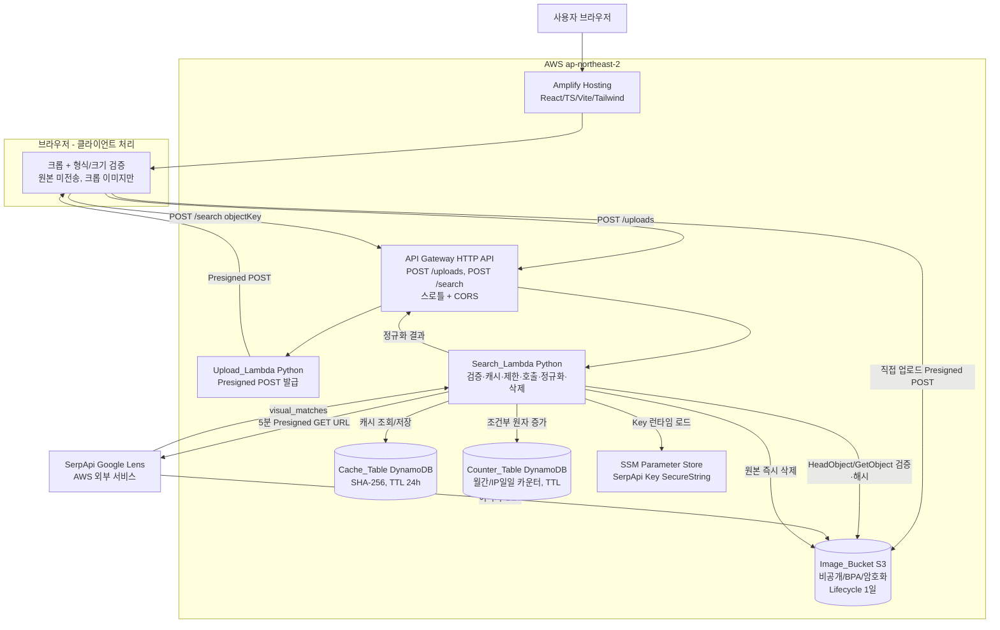
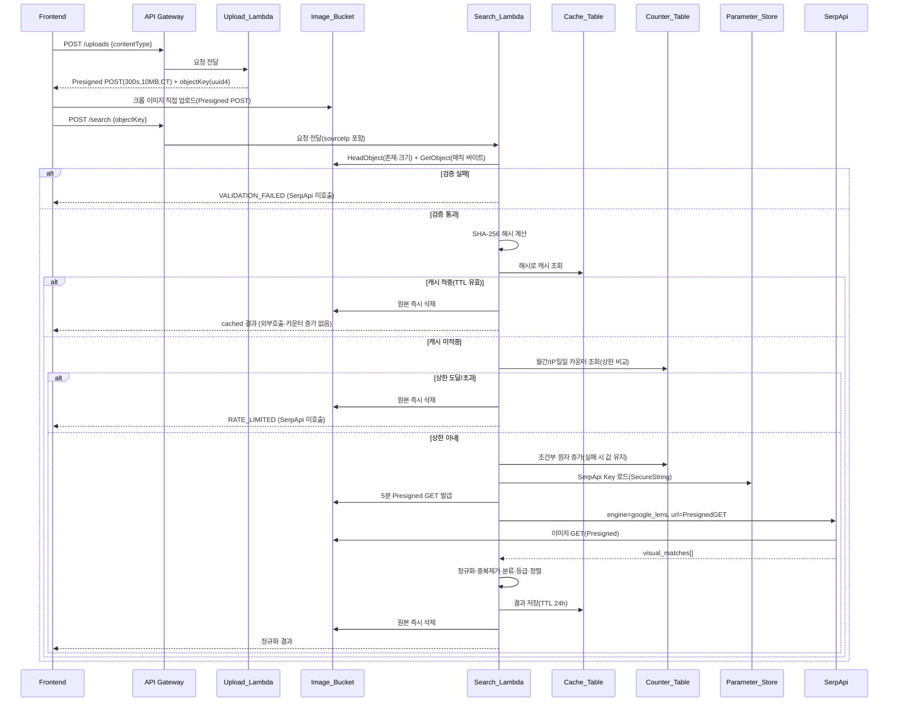
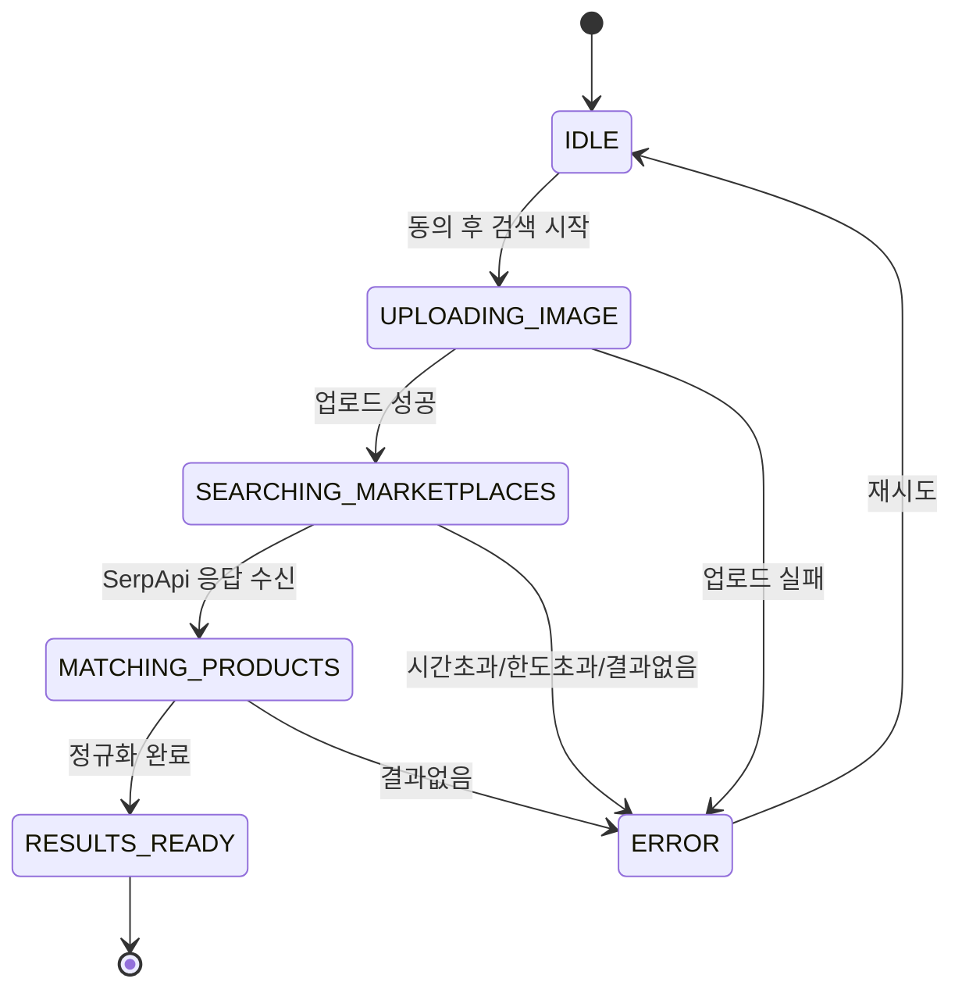

# 설계 문서 (Design Document)

## Overview

CLOSELLER 1차 MVP는 "업로드 → 브라우저 크롭 → 외부 검색(SerpApi Google Lens) → 결과 표시"의 핵심 흐름만 구현한다. 사용자가 패션 사진을 올리고 사진 속 옷 영역을 크롭하면, 크롭된 이미지만 서버에 업로드되고, Search_Lambda가 SerpApi Google Lens API를 호출해 실제 판매 상품 후보를 찾아 상품 카드로 보여준다. 가격은 검색 API가 반환한 통화 그대로 표시하며, 환율 변환은 하지 않는다.

모든 인프라는 AWS에서 실행되며(Amplify Hosting, API Gateway HTTP API, Lambda(Python), S3, DynamoDB, SSM Parameter Store), 외부 검색은 SerpApi Google Lens API만 사용한다. 리전은 서울(ap-northeast-2)이며 환경변수로 변경 가능하다.

### 범위 (In Scope)

- 사진 업로드(드래그앤드롭, 파일 선택, 모바일 카메라/앨범)
- 브라우저 내 크롭(원본은 서버 전송 안 함)
- 외부 전송 동의 게이트
- Presigned POST 직접 업로드, 서버 재검증(존재/크기/매직 바이트)
- SHA-256 캐시, 월간/IP별 호출 제한, API Gateway 스로틀
- SerpApi Google Lens 호출(5분 Presigned GET으로만 S3 접근)
- 결과 정규화·중복 제거·플랫폼 분류·일치도 등급 산정·정렬
- 원본 이미지 즉시 삭제 + S3 Lifecycle(1일)
- RESULTS 화면 상품 카드, 정렬/필터, 오류 화면
- 테스트 모드(USE_MOCK_SEARCH)
- AWS SAM 인프라 정의, 문서화

### 제외 (Out of Scope — 미리 만들지 않는다)

- 의류 분석(Bedrock) — 설계하지 않음
- 로그인/회원(Cognito) — 설계하지 않음
- 검색 기록 / 관심 상품 저장 — 설계하지 않음
- 환율 변환 — 설계하지 않음(가격은 반환된 통화 그대로 표시)
- ARCHIVE 화면 — "COMING SOON" 안내만 제공(기능 미설계)

### 외부 서비스 공식 출처

SerpApi Google Lens API 공식 문서: [SerpApi Google Lens API](https://serpapi.com/google-lens-api). 본 설계는 공식 문서에 명시된 요청 파라미터와 응답 필드만 사용한다. 문서에 없는 필드는 추측해서 사용하지 않는다(Req 8.5, 8.6, 9.9).

### 승인 규칙 (중요)

본 설계는 `.kiro/steering/closeller.md`의 승인 규칙을 따른다.

- **승인 전 실행 금지**: `sam deploy`, AWS 리소스 생성/변경/삭제, 실제 SerpApi_Service 호출. 이 작업들은 명령어와 예상 영향만 제시하고 사용자 승인을 기다린다(Req 23.1).
- **승인 불필요**: 로컬 파일 생성, 빌드, 테스트, `sam validate`, `sam build`는 승인 없이 수행한다(Req 23.2).

## Architecture

### 전체 시스템 구조



### 데이터 흐름 (검색 시퀀스)



### 경계 규칙 (Trust Boundaries)

- **외부 API 호출은 Search_Lambda에서만** 수행한다. 프론트엔드와 Upload_Lambda는 SerpApi를 호출하지 않는다(Req 21.6).
- **프론트엔드에 외부 API Key를 포함하지 않는다**(Req 21.5). SerpApi Key는 Search_Lambda가 런타임에 SSM SecureString에서만 읽는다(Req 8.4, 21.4).
- **크롭된 이미지만 업로드**된다. 원본 이미지는 브라우저를 떠나지 않는다(Req 2.4).
- **IP 주소는 서버가 `requestContext.http.sourceIp`에서 읽고** 단방향 해시로만 저장한다. 원본 IP는 저장하지 않으며 요청 본문에서 IP를 받지 않는다(Req 7.8).

## Components and Interfaces

### Frontend 화면 구성

| 화면 | 경로 | 역할 | 비고 |
|------|------|------|------|
| HOME | `/` | 메인 랜딩, 업로드 진입 | 메인 문구 표시 |
| VISUAL SEARCH | `/search` | 미리보기, 크롭, 동의, 검색 시작, 진행 상태 | 핵심 흐름 |
| RESULTS | `/results` | 상품 카드 그리드, 정렬/필터 | |
| ARCHIVE | `/archive` | "COMING SOON" 안내만 | 기능 미설계(Req 18.2) |
| ABOUT | `/about` | 서비스 소개, Match_Grade 휴리스틱 명시 | Req 11.7 |

**메인 문구(그대로 사용):**

```
CLOSELLER.
FIND WHAT THEY WEAR.
UPLOAD. IDENTIFY. DISCOVER.
사진 한 장으로 당신이 찾던 옷을 발견하세요.
```

### Frontend 컴포넌트

| 컴포넌트 | 책임 | 관련 요구사항 |
|----------|------|---------------|
| `UploadDropzone` | 드래그앤드롭 영역 + 파일 선택 버튼. 모바일에서 `capture`(카메라)와 앨범 선택 입력 제공 | 1.1, 1.2 |
| `ImagePreview` | 선택된 이미지 미리보기 표시 | 1.3 |
| `ClientFileValidator` | 형식(JPG/PNG/WEBP)·크기(10MB) 클라이언트 검증, 거부 메시지 | 1.4, 1.5 |
| `CropTool` | 브라우저 내 크롭(canvas). 크롭 결과만 업로드 대상 | 2.1, 2.2, 2.3, 2.4 |
| `ConsentGate` | 외부 전송 안내 문구 + Consent_Checkbox. 미동의 시 검색 비활성화 | 3.1, 3.2, 3.3 |
| `SearchProgress` | 진행 상태 4단계 표시 | 13.1, 13.2 |
| `ResultGrid` / `ProductCard` | 결과 그리드와 상품 카드 | 14.1, 14.2, 14.3, 14.4 |
| `SortControls` | 가격 낮은순/높은순/일치도 정렬 | 15.1~15.7 |
| `FilterControls` | 국내·해외 / 동일·유사 / 플랫폼 필터 | 16.1, 16.2, 16.3 |
| `ErrorNotice` | 오류 유형별 한국어 메시지 | 17.1~17.4 |
| `TestDataBadge` | source=MOCK 결과에 "TEST DATA" 배지, 구매 버튼 비활성화 | 19.3, 19.4 |

**상태 관리**: 경량 접근(React `useState` + Context 또는 Zustand 수준). 저장/영속화 상태는 두지 않는다(저장 기능 범위 밖).

### 진행 상태 머신



진행 표시 라벨: `UPLOADING IMAGE` → `SEARCHING MARKETPLACES` → `MATCHING PRODUCTS` → `RESULTS READY`(Req 13.1).

### API 클라이언트

- 베이스 URL은 `VITE_API_BASE_URL` 환경변수로 받는다.
- 외부 API Key를 **포함하지 않는다**(Req 21.5). API Gateway 두 라우트만 호출한다.

### 디자인 토큰

| 토큰 | 값 | 비고 |
|------|------|------|
| 배경 | `#0A0A0A` | |
| 보조 배경(surface) | `#181818` | |
| 글자 | `#F5F5F5` | |
| 포인트(accent) | `#C5F277` | |
| 타이포 | 큰 볼드, 모노톤 | 럭셔리 에디토리얼 |
| 질감 | 은은한 필름 그레인 | |
| 금지 | 네온, 그라데이션, 과한 그림자 | Req 18.3 |
| 레이아웃 | 모바일/PC 반응형, 상품 이미지 중심 그리드, 자연스러운 호버 | Req 18.4 |

### Upload_Lambda (POST /uploads)

**요청 스키마**
```json
{ "contentType": "image/jpeg | image/png | image/webp" }
```

**응답 스키마**
```json
{
  "objectKey": "uploads/<uuid4>",
  "upload": { "url": "https://<bucket>.s3...", "fields": { "key": "...", "Content-Type": "...", "policy": "...", "x-amz-signature": "..." } },
  "expiresInSeconds": 300
}
```

**동작**
- Presigned POST 발급: 유효 300초, `content-length-range` 최대 10MB, 허용 `Content-Type`(image/jpeg, image/png, image/webp) 고정(Req 4.2).
- 객체 키는 버전 4 랜덤 UUID(`uploads/{uuid4}`)로 생성(Req 4.4).
- 원본 파일명을 저장하지 않는다(Req 4.5).
- 3초 이내 응답(Req 4.2).
- **외부 호출 없음**. S3 presign 권한만 사용.

### Search_Lambda (POST /search)

**요청 스키마**
```json
{ "objectKey": "uploads/<uuid4>", "clientRequestId": "optional-string" }
```
IP는 본문이 아니라 서버가 `event.requestContext.http.sourceIp`에서 읽는다(Req 7.8).

**응답 스키마**
```json
{
  "source": "SERP | MOCK",
  "cached": true,
  "currencyMixed": false,
  "results": [ /* NormalizedResult[] */ ]
}
```

**오류 코드표**

| errorCode | 의미 | 관련 요구사항 |
|-----------|------|---------------|
| `UPLOAD_FAILED` | 업로드 실패(프론트에서 업로드 단계 실패 식별) | 17.1 |
| `VALIDATION_FAILED` | 객체 미존재/크기 초과/매직 바이트 불일치 | 5.4, 17 |
| `SEARCH_TIMEOUT` | 검색 처리 시간 초과 | 17.2 |
| `NO_RESULTS` | 정규화 후 결과 0건 | 17.3 |
| `RATE_LIMITED` | 월간/IP 일일 상한 초과 | 7.6, 7.7, 17.4 |
| `INTERNAL_ERROR` | 기타 내부 오류 | — |

**모듈 분리표** (순수 로직은 핸들러와 분리, 단위/속성 테스트 대상)

| 모듈 | 종류 | 책임 | 관련 요구사항 |
|------|------|------|---------------|
| `validation.py` | 순수 | 크기·매직 바이트(JPG/PNG/WEBP) 검증 | 5.2, 5.3 |
| `hashing.py` | 순수 | 이미지 바이트 SHA-256, IP 단방향 해시 | 6.1, 7.8 |
| `url_tools.py` | 순수 | URL 정규화(스킴/호스트 소문자, 추적쿼리·프래그먼트 제거, 끝 슬래시 제거), 스킴 검사 | 9.6, 9.8 |
| `normalize.py` | 순수 | visual_matches → NormalizedResult, 필수필드 필터, 가격 파싱, 중복제거, 정렬 | 9.1~9.9 |
| `platform_map.py` | 순수 | 도메인 → 플랫폼·국내/해외 분류 | 10.1~10.6 |
| `match_grade.py` | 순수 | 유형·순위 → Match_Grade | 11.1~11.6 |
| `mock.py` | 순수 | 고정 MOCK 데이터(example.com) 생성 | 19.1, 19.2, 19.5 |
| `cache.py` | I/O | Cache_Table 조회/저장(TTL 24h) | 6.2, 6.3, 6.4 |
| `rate_limit.py` | I/O | Counter_Table 조회·조건부 원자 증가 | 7.1~7.8 |
| `serp_client.py` | I/O | SerpApi google_lens 호출(공식 필드만) | 8.3~8.6 |
| `cleanup.py` | I/O | 원본 이미지 즉시 삭제 | 12.1 |
| `handler.py` | I/O | 파이프라인 조립, 오류 매핑 | 전반 |

**파이프라인 단계**: 검증 → SHA-256 해시 → 캐시 조회 → (미적중) 호출 제한 확인·증가 → Presigned GET 발급 → SerpApi 호출 → 정규화/분류/산정/정렬 → 캐시 저장 → 원본 즉시 삭제(성공·실패 무관).

**SerpApi 요청/응답 매핑표** (공식 문서 필드만 — [SerpApi Google Lens API](https://serpapi.com/google-lens-api))

요청 파라미터:

| 파라미터 | 값 | 비고 |
|----------|------|------|
| `engine` | `google_lens` | 고정 |
| `url` | 5분 Presigned GET URL | S3 이미지 |
| `api_key` | SSM SecureString | 런타임 로드 |
| `type` | `visual_matches` (선택) | 상품 결과 |
| `country`, `hl` | 선택 | — |

응답(`visual_matches[]`) → NormalizedResult 매핑:

| NormalizedResult 필드 | SerpApi 출처 필드 | 처리 |
|-----------------------|-------------------|------|
| `title` | `title` | 비면 결과 제외 |
| `link` | `link` | 판매 페이지 URL, 비면/비 http(s)면 제외 |
| `imageUrl` | `image` (없으면 `thumbnail`) | 둘 다 없으면 제외 |
| `price` / `currency` | `price.value` / `price.currency` | 그대로 보존 |
| `priceSortValue` | `price.extracted_value` | 없거나 파싱 불가 시 null, 가격 "미확인" |
| `matchType` | `exact_matches == true` | true → "동일 상품 후보", 아니면 "유사 상품" |
| `matchGrade` | (`matchType`, `position`) | match_grade.py |
| `platform` / `region` | `link` 도메인 | platform_map.py |
| `brand` | (전용 필드 없음) | 기본 미포함 (아래 참조) |
| `source` | — | "SERP" 고정 |

**브랜드 미포함 사유**: SerpApi `visual_matches`에는 브랜드 전용 필드가 없다. 데이터 정직성 규칙상 응답에 없는 값을 추론해 채우지 않으므로(Req 8.6, 9.3, 9.9), 브랜드는 기본적으로 미포함으로 설계한다. `title`에 브랜드가 포함되는 것은 그대로 노출될 뿐 별도 브랜드 필드로 추출·추정하지 않는다. (Req 9.3은 "브랜드 정보가 포함되면" 조건부 — 응답에 명시적 브랜드가 없으므로 조건이 성립하지 않는다.)

### API Gateway

- HTTP API, 라우트: `POST /uploads`(Upload_Lambda), `POST /search`(Search_Lambda) (Req 20.4).
- 스로틀: `rate` 기본 초당 2건, `burst` 기본 5건. 환경변수로 설정, 허용 범위 각 1~10,000 정수(Req 7.9).
- CORS: 허용 출처를 파라미터로 받는다(Req 20.1, 20.4).

## Data Models

### NormalizedResult (TypeScript)

```typescript
export type MatchType = "동일 상품 후보" | "유사 상품";
export type MatchGrade = "높음" | "보통" | "낮음";
export type Region = "국내" | "해외" | "미확인";
export type ResultSource = "SERP" | "MOCK";

export interface NormalizedResult {
  title: string;              // 상품명 (필수)
  link: string;               // 판매 페이지 URL (필수, http/https)
  imageUrl: string;           // 상품 이미지 URL (필수)
  price: string;              // 표시용 가격 문자열 또는 "미확인"
  currency: string | null;    // 통화 코드, 없으면 null
  priceSortValue: number | null; // 정렬용 숫자값, 없으면 null
  platform: string;           // 판매 플랫폼명
  region: Region;             // 국내/해외/미확인
  matchType: MatchType;       // 동일 상품 후보 / 유사 상품
  matchGrade: MatchGrade;     // 높음/보통/낮음
  brand?: string;             // 기본 미포함 (SerpApi 브랜드 전용 필드 없음)
  source: ResultSource;       // SERP / MOCK
}
```

### NormalizedResult (Python dataclass)

```python
from dataclasses import dataclass
from typing import Optional

@dataclass(frozen=True)
class NormalizedResult:
    title: str
    link: str
    image_url: str
    price: str              # 숫자 문자열 또는 "미확인"
    currency: Optional[str]
    price_sort_value: Optional[float]
    platform: str
    region: str             # "국내" | "해외" | "미확인"
    match_type: str         # "동일 상품 후보" | "유사 상품"
    match_grade: str        # "높음" | "보통" | "낮음"
    source: str             # "SERP" | "MOCK"
    brand: Optional[str] = None
```

### Cache_Table (DynamoDB)

| 속성 | 타입 | 설명 |
|------|------|------|
| `imageHash` (PK) | String | 이미지 바이트 SHA-256 |
| `results` | String(JSON) | 정규화 결과 배열 |
| `currencyMixed` | Bool | 통화 혼재 여부 |
| `createdAt` | Number(epoch) | 생성 시각 |
| `ttl` | Number(epoch) | `createdAt + 86400` (24시간) — DynamoDB TTL |

- Provisioned 소용량, TTL 24시간(Req 6.4, 20.2).

### Counter_Table (DynamoDB)

| 속성 | 타입 | 설명 |
|------|------|------|
| `counterId` (PK) | String | 월간: `GLOBAL#YYYY-MM` / 일일: `IP#<sha256(ip)>#YYYY-MM-DD` |
| `count` | Number | 현재 호출 수 |
| `ttl` | Number(epoch) | 기간 경과 후 자동 삭제 |

- **기간 리셋**: 키에 기간(YYYY-MM, YYYY-MM-DD)을 포함해 월/일 카운터가 자연 분리된다. 별도 리셋 작업이 필요 없다.
- **조건부 원자 증가**: SerpApi 호출 직전, 월간/IP일일 카운터를 각각 1씩 원자적으로 증가.
  ```
  UpdateExpression:  SET #c = if_not_exists(#c, :zero) + :one, #ttl = :ttl
  ConditionExpression:  attribute_not_exists(#c) OR #c < :limit
  ```
  조건 실패(증가 후 상한 초과) 시 증가 전 값 유지 + `RATE_LIMITED` 반환(Req 7.5, 7.6).
- **상한**: 월간 전체 기본 200, IP별 일일 기본 5. 환경변수, 허용 범위 1~1,000,000 정수(Req 7.3, 7.4).
- **IP 저장**: SHA-256 단방향 해시만 저장. 원본 IP 미저장(Req 7.8).
- 캐시 적중 시 카운터 증가 없음(Req 7.2).

### Platform_Map

도메인 → (플랫폼명, 국내/해외):

| 도메인 | 플랫폼 | 구분 |
|--------|--------|------|
| `fruitsfamily.com` | 후루츠패밀리 | 국내 |
| `bunjang.co.kr`, `m.bunjang.co.kr` | 번개장터 | 국내 |
| `musinsa.com` | 무신사 | 국내 |
| `kream.co.kr` | KREAM | 국내 |
| `ebay.com` | eBay | 해외 |
| `grailed.com` | Grailed | 해외 |
| `vestiairecollective.com` | Vestiaire Collective | 해외 |

**분류 알고리즘**:
1. `link`에서 호스트 추출 → 소문자 변환 → 선행 `www.` 제거.
2. Platform_Map 조회 → 적중 시 플랫폼명과 국내/해외 구분 반환(Req 10.1, 10.4).
3. 미적중이고 브랜드 공식 홈페이지로 볼 근거가 있으면 "공식 홈페이지 후보", 구분 "미확인"(Req 10.2, 10.5).
4. 미적중이고 근거 없으면 "기타", 구분 "미확인"(Req 10.3, 10.5).
- Platform_Map은 `platform_map.py` 한 곳에서 관리하고 단위 테스트를 둔다(Req 10.6).

### Match_Grade 산정표

| matchType | position 범위 | Match_Grade |
|-----------|---------------|-------------|
| 동일 상품 후보 | 1~3 | 높음 |
| 동일 상품 후보 | 4~10 | 보통 |
| 동일 상품 후보 | ≥11 | 낮음 |
| 유사 상품 | 1~3 | 보통 |
| 유사 상품 | ≥4 | 낮음 |
| (모든 유형) | 순위 없음/무효 | 낮음 |

- 숫자 점수를 쓰지 않고 "높음/보통/낮음" 3등급만 산정(Req 11.5, 11.6). 휴리스틱임을 코드 주석과 ABOUT 화면에 명시(Req 11.7).

### 정규화 · 중복 제거 · 정렬 규칙

- **URL 정규화**(중복 판정 기준): 스킴·호스트 소문자 변환, 추적용 쿼리 파라미터 및 프래그먼트 제거, 끝 슬래시 제거(Req 9.6).
- **중복 제거**: 정규화 URL이 동일한 결과 중 첫 번째 1건만 유지(Req 9.6).
- **필수 필드 필터**: 상품명·이미지 URL·판매 페이지 URL 중 하나라도 비거나 누락이면 제외(Req 9.2). 스킴이 http/https가 아니면 제외(Req 9.8).
- **가격**: `price.value`/`price.currency` 그대로 보존, `price.extracted_value`를 정렬 숫자로. 없거나 파싱 불가 시 가격 "미확인" + `priceSortValue=null`, 결과는 유지(Req 9.5).
- **서버 기본 정렬**(Req 9.7): 가격이 "미확인"이 아닌 결과를 가격 오름차순, 가격 동일 또는 "미확인"인 결과는 상품명 가나다순.
- SerpApi 응답에 없는 가격/상품/링크 값을 생성·추론하지 않는다(Req 9.9).

## Correctness Properties

*속성(property)이란 시스템의 모든 유효한 실행에서 참이어야 하는 특성이나 동작으로, 시스템이 무엇을 해야 하는지에 대한 형식적 진술이다. 속성은 사람이 읽는 명세와 기계가 검증할 수 있는 정확성 보장 사이의 다리 역할을 한다.*

아래 속성은 위 prework 분석을 근거로, 속성 테스트에 적합한 순수 로직(검증·해시·캐시/카운터·정규화·분류·등급·정렬·필터·Mock)을 대상으로 작성했다. 각 속성은 100회 이상 반복되는 단일 속성 기반 테스트로 구현한다.

### Property 1: 업로드 키는 UUID v4이며 원본 파일명 미포함

*For any* 업로드 요청, Upload_Lambda가 생성하는 객체 키는 `uploads/<UUID v4>` 형식이며 원본 파일명 조각을 포함하지 않는다.

**Validates: Requirements 4.4, 4.5**

### Property 2: Presigned POST 정책은 300초·10MB·Content-Type 고정 조건 포함

*For any* 허용 Content-Type 입력, 발급되는 Presigned POST 정책은 유효기간 300초, content-length-range 최대 10MB, 고정 Content-Type 조건을 항상 포함한다.

**Validates: Requirements 4.2**

### Property 3: 클라이언트 형식 검증은 jpeg/png/webp만 통과

*For any* 파일 형식(MIME/확장자) 입력, 클라이언트 형식 검증은 image/jpeg, image/png, image/webp인 경우에만 통과하고 그 외는 거부한다.

**Validates: Requirements 1.4**

### Property 4: 매직 바이트 검증은 실제 JPG/PNG/WEBP만 통과

*For any* 바이트 입력, 서버 매직 바이트 검증은 실제 JPG/PNG/WEBP 시그니처를 가진 경우에만 통과하고 그 외(크기 초과 포함)는 거부한다.

**Validates: Requirements 5.2, 5.3**

### Property 5: 검증 실패 입력은 SerpApi 미호출

*For any* 서버 검증(존재/크기/매직 바이트)에 실패하는 입력, Search_Lambda는 SerpApi_Service를 호출하지 않고 검증 실패 오류를 반환한다.

**Validates: Requirements 5.4**

### Property 6: SHA-256 해시 결정성

*For any* 이미지 바이트, 동일 바이트는 항상 동일한 SHA-256 해시를 산출하고 서로 다른 바이트는 서로 다른 해시를 산출한다.

**Validates: Requirements 6.1**

### Property 7: 캐시 적중 시 외부호출·카운터 증가 없음

*For any* 유효한 캐시 항목이 존재하는 이미지, Search_Lambda는 캐시된 결과를 반환하며 SerpApi_Service를 호출하지 않고 월간/IP 일일 카운터를 증가시키지 않는다.

**Validates: Requirements 6.3, 7.2**

### Property 8: 캐시 저장 TTL 항상 24시간

*For any* 새로 저장되는 캐시 항목, `ttl` 값은 항상 `createdAt + 86400`(24시간)과 같다.

**Validates: Requirements 6.4**

### Property 9: 호출 카운터는 상한 절대 초과하지 않음

*For any* 상한 값과 임의의 호출 증가 시퀀스, 카운터 값은 상한을 절대 초과하지 않으며, 상한에 도달한 상태에서의 증가 시도는 실패하여 값이 유지되고 SerpApi_Service가 호출되지 않는다.

**Validates: Requirements 7.5, 7.6, 7.7**

### Property 10: IP는 단방향 해시로만 저장

*For any* 요청 IP 주소, Counter_Table에 저장되는 값은 단방향 해시이며 원본 IP 주소를 포함하지 않는다.

**Validates: Requirements 7.8**

### Property 11: 정규화 결과는 필수 필드 모두 보유, 누락 시 제외

*For any* SerpApi visual_matches 입력 집합, 정규화된 모든 결과는 상품명·이미지 URL·판매 페이지 URL을 모두 보유하며, 세 필드 중 하나라도 비거나 누락된 입력은 결과에서 제외된다.

**Validates: Requirements 9.1, 9.2**

### Property 12: 가격 값과 통화는 변조 없이 보존

*For any* 가격·통화 정보가 있는 결과, 정규화 결과의 가격 값과 통화는 SerpApi 응답 값과 동일하게 보존되며 임의로 생성·추론되지 않는다.

**Validates: Requirements 9.4, 9.9**

### Property 13: 가격 없으면 "미확인"·priceSortValue null·결과 유지

*For any* 가격이 없거나 숫자로 파싱할 수 없는 결과, 정규화 결과의 가격은 "미확인", priceSortValue는 null이 되며 해당 결과는 제외되지 않고 유지된다.

**Validates: Requirements 9.5, 9.9**

### Property 14: 중복 제거 후 정규화 URL 유일, 그룹당 첫 1건

*For any* 정규화 URL(스킴·호스트 소문자, 추적 쿼리·프래그먼트 제거, 끝 슬래시 제거)이 같은 결과 그룹, 정규화 결과에는 각 정규화 URL이 정확히 하나만 존재하며 해당 그룹의 첫 번째 결과만 남는다.

**Validates: Requirements 9.6**

### Property 15: 모든 결과 링크는 http/https

*For any* 정규화 결과, 판매 페이지 URL의 스킴은 항상 http 또는 https이며 그 외 스킴을 가진 입력은 제외된다.

**Validates: Requirements 9.8**

### Property 16: 도메인 분류는 플랫폼·국내/해외 일관 결정, 미적중·근거없음→기타·미확인

*For any* 판매 페이지 도메인, 분류 결과는 결정적이며, Platform_Map에 정의된 도메인은 해당 플랫폼과 국내/해외 구분으로, 매핑되지 않고 분류 근거가 없는 도메인은 "기타"·국내/해외 "미확인"으로 분류된다.

**Validates: Requirements 10.1, 10.3, 10.4, 10.5**

### Property 17: Match_Grade는 유형·순위로 결정·항상 3등급 중 하나·숫자 금지

*For any* (matchType, position) 쌍, Match_Grade는 산정표대로 결정되며 값은 항상 "높음"·"보통"·"낮음" 중 하나이고(순위가 없거나 무효이면 "낮음") 숫자 점수를 사용하지 않는다.

**Validates: Requirements 11.3, 11.4, 11.5, 11.6**

### Property 18: 동일/유사 유형은 exact_matches로 결정

*For any* visual_matches 항목, `exact_matches == true`이면 "동일 상품 후보"로, 그렇지 않으면 "유사 상품"으로 구분된다.

**Validates: Requirements 11.1, 11.2**

### Property 19: 검색 완료 시 원본 이미지 항상 삭제(모든 경로)

*For any* 검색 처리 경로(성공·검증 실패·한도 초과·SerpApi 실패), Search_Lambda는 Image_Bucket의 원본 이미지를 즉시 삭제한다.

**Validates: Requirements 12.1**

### Property 20: 가격 정렬 오름/내림+미확인 항상 뒤+안정 정렬

*For any* 결과 목록, 가격 낮은순/높은순 정렬은 가격이 "미확인"이 아닌 결과를 숫자값 오름차순/내림차순으로 배치하고, "미확인" 결과를 항상 뒤에 두며, 동률은 원래 순서를 유지한다(안정 정렬).

**Validates: Requirements 15.1, 15.2, 15.3, 15.6**

### Property 21: 일치도 정렬 높음>보통>낮음+안정 정렬

*For any* 결과 목록, 일치도 높은순 정렬은 Match_Grade를 높음>보통>낮음 순서로 배치하며 동일 등급은 원래 순서를 유지한다(안정 정렬).

**Validates: Requirements 15.5, 15.6**

### Property 22: 통화 혼재 시 값 보존+currencyMixed=true

*For any* 서로 다른 통화가 섞인 결과 목록, 각 결과의 가격 값과 통화는 변환 없이 보존되고 currencyMixed 플래그가 true로 설정된다.

**Validates: Requirements 15.4**

### Property 23: 필터 결과는 정확한 부분집합

*For any* 결과 목록과 필터 선택(국내/해외, 동일/유사, 플랫폼), 필터링된 결과는 선택 조건을 만족하는 원본 목록의 정확한 부분집합이며 조건에 맞지 않는 결과를 포함하지 않는다.

**Validates: Requirements 16.1, 16.2, 16.3**

### Property 24: Mock 모드는 외부 미호출+source=MOCK+안전 링크만

*For any* `USE_MOCK_SEARCH=true` 상태의 검색, Search_Lambda는 SerpApi_Service를 호출하지 않고 모든 결과에 source "MOCK"을 포함하며 실제 상점처럼 보이는 링크 대신 안전한 예시 도메인(example.com)만 사용한다.

**Validates: Requirements 19.1, 19.2, 19.5**

### Property 25: MOCK 결과 렌더는 TEST DATA 배지+구매 비활성, SERP는 활성

*For any* 결과, source가 "MOCK"이면 렌더 시 "TEST DATA" 배지가 표시되고 구매 버튼이 비활성화되며, source가 "SERP"이면 배지가 없고 구매 버튼이 활성화된다.

**Validates: Requirements 19.3, 19.4**

### Property 26: 동의 상태와 검색 시작 가능 여부 일치

*For any* 동의 상태, 검색 시작 동작의 활성 여부는 Consent_Checkbox가 선택된 상태와 정확히 일치한다.

**Validates: Requirements 3.2**

### 속성 ↔ 증거(테스트) 연결

| 속성 | 구현 테스트(파일) | 대상 모듈 |
|------|-------------------|-----------|
| P1 | `test_upload_key.py` | Upload_Lambda(키 생성) |
| P2 | `test_presigned_policy.py` | Upload_Lambda(정책) |
| P3 | `frontend: fileValidator.test.ts` | `ClientFileValidator` |
| P4 | `test_validation.py` | `validation.py` |
| P5 | `test_handler_validation_gate.py` | `handler.py`(serp_client 모킹) |
| P6 | `test_hashing.py` | `hashing.py` |
| P7 | `test_cache_hit.py` | `cache.py`+`handler.py` |
| P8 | `test_cache_ttl.py` | `cache.py` |
| P9 | `test_rate_limit.py` | `rate_limit.py` |
| P10 | `test_ip_hash.py` | `hashing.py`+`rate_limit.py` |
| P11 | `test_normalize_required.py` | `normalize.py` |
| P12 | `test_normalize_price_preserve.py` | `normalize.py` |
| P13 | `test_normalize_price_missing.py` | `normalize.py` |
| P14 | `test_dedup.py` | `url_tools.py`+`normalize.py` |
| P15 | `test_scheme_filter.py` | `url_tools.py` |
| P16 | `test_platform_map.py` | `platform_map.py` |
| P17 | `test_match_grade.py` | `match_grade.py` |
| P18 | `test_match_type.py` | `normalize.py` |
| P19 | `test_cleanup_all_paths.py` | `cleanup.py`+`handler.py` |
| P20 | `frontend: sortPrice.test.ts` | `SortControls` 로직 |
| P21 | `frontend: sortGrade.test.ts` | `SortControls` 로직 |
| P22 | `frontend: currencyMixed.test.ts` | 정규화/정렬 로직 |
| P23 | `frontend: filter.test.ts` | `FilterControls` 로직 |
| P24 | `test_mock_mode.py` | `mock.py`+`handler.py` |
| P25 | `frontend: productCard.test.tsx` | `ProductCard`/`TestDataBadge` |
| P26 | `frontend: consentGate.test.tsx` | `ConsentGate` |

**속성 테스트 태그 형식**(각 속성 테스트에 주석으로 부착):

```
# Feature: closeller-mvp, Property {번호}: {속성 텍스트}
```

예: `# Feature: closeller-mvp, Property 9: 호출 카운터는 상한 절대 초과하지 않음`

## 보안 설계

| 항목 | 설계 | 관련 요구사항 |
|------|------|---------------|
| S3 공개 차단 | Block Public Access 전체 활성, 서버 측 암호화 | 20.1 |
| Presigned GET | 유효 5분, SerpApi 이미지 접근 전용 | 8.1 |
| Presigned POST | 유효 5분(300초), 10MB·Content-Type 제한 | 4.2 |
| IAM 최소 권한 | 각 Lambda에 필요한 ARN만 부여, 리소스 와일드카드(*) 금지 | 20.3, 20.8 |
| 비밀값 | SerpApi Key는 SSM SecureString, 런타임 로드, template.yaml에 값 미포함 | 8.4, 20.5, 21.4 |
| IP 보호 | SHA-256 단방향 해시만 저장, 원본 IP 미저장 | 7.8 |
| CORS | 허용 출처를 파라미터로 지정 | 20.1, 20.4 |
| 프론트 키 | 프론트엔드에 외부 API Key 미포함 | 21.5 |
| 외부 호출 경계 | 외부 API 호출은 Search_Lambda만 수행 | 21.6 |
| 원본 삭제 | 검색 완료 즉시 삭제 + Lifecycle 1일 이중 삭제 | 12.1, 12.2 |
| 서버 재검증 | 존재·크기·매직 바이트 서버 검증 | 5.1~5.3 |
| 외부 전송 동의 | 업로드 전 안내·동의 게이트 | 3.1~3.3 |

## 비용 설계

| 항목 | 설계 | 관련 요구사항 |
|------|------|---------------|
| DynamoDB | Provisioned 소용량(무료 한도 대상), TTL 적용 | 20.2 |
| 상시 유료 리소스 | EC2/RDS/NAT Gateway 등 미정의 | 20.9 |
| CloudWatch 로그 | 보존 14일 | 20.6 |
| Lambda | 작은 메모리, 짧은 타임아웃 | 20.3 |
| SerpApi 비용 보호 | SHA-256 캐시(24h) + 월간/IP 호출 제한 + API Gateway 스로틀 | 6.x, 7.x |
| S3 수명 | Lifecycle 1일 자동 삭제 | 12.2, 20.1 |

## Error Handling

errorCode → 프론트엔드 한국어 메시지 매핑(각 유형을 구분해 표시):

| 상황 | errorCode | 프론트 메시지(예) | 관련 요구사항 |
|------|-----------|-------------------|---------------|
| 업로드 실패 | `UPLOAD_FAILED` | "이미지 업로드에 실패했습니다. 잠시 후 다시 시도해 주세요." | 17.1 |
| 시간 초과 | `SEARCH_TIMEOUT` | "검색 시간이 초과되었습니다. 다시 시도해 주세요." | 17.2 |
| 결과 없음 | `NO_RESULTS` | "검색 결과가 없습니다. 다른 사진이나 다른 크롭 영역으로 시도해 보세요." | 17.3 |
| 한도 초과 | `RATE_LIMITED` | "현재 검색 요청이 많아 한도를 초과했습니다. 잠시 후 다시 시도해 주세요." | 17.4, 7.6, 7.7 |
| 검증 실패 | `VALIDATION_FAILED` | "이미지를 확인할 수 없습니다. JPG/PNG/WEBP, 10MB 이하 파일을 사용해 주세요." | 5.4 |
| 내부 오류 | `INTERNAL_ERROR` | "일시적인 오류가 발생했습니다. 다시 시도해 주세요." | — |

- 각 오류는 전용 메시지로 구분해 표시한다(Req 17.1~17.4). 백엔드는 안정적 `errorCode`를, 프론트는 해당 코드에 매핑된 한국어 메시지를 보여준다.

## 테스트 모드 설계

- `USE_MOCK_SEARCH=true`이면 Search_Lambda는 SerpApi_Service를 호출하지 않고 `mock.py`의 고정 데이터를 반환한다(Req 19.1).
- Mock 결과의 각 항목은 `source="MOCK"`을 포함한다(Req 19.2).
- 테스트 데이터의 링크는 실제 상점처럼 보이는 가짜 링크를 쓰지 않고 예시 도메인(`example.com`)만 사용한다(Req 19.5).
- Mock 모드에서도 월간/IP 카운터를 증가시키지 않는다(외부 호출이 없으므로 카운터 증가 로직을 타지 않는다).
- 프론트엔드는 `source="MOCK"` 결과에 "TEST DATA" 배지를 표시하고 구매 버튼을 비활성화한다(Req 19.3, 19.4).
- API Key 없이 `sam local`로 업로드→크롭→결과 표시의 전체 흐름을 로컬에서 수행한다(Req 19.6).

## Testing Strategy

본 기능은 순수 변환·분류·정렬 로직이 핵심이어서 속성 기반 테스트(PBT)가 적합하다. UI 렌더·라우팅·인프라 구성은 예시/스냅샷/검증 도구로 다룬다.

### 백엔드 (Python)

- **프레임워크**: `pytest` + `hypothesis`(속성 기반). PBT를 직접 구현하지 않고 Hypothesis를 사용한다.
- **반복 횟수**: 각 속성 테스트 최소 100회(`@settings(max_examples=100)` 이상).
- **태그**: 각 속성 테스트에 주석 `# Feature: closeller-mvp, Property {번호}: {속성 텍스트}`.
- **속성 테스트 대상(순수 모듈)**: `validation.py`(P4), `hashing.py`(P6, P10), `url_tools.py`(P14, P15), `normalize.py`(P11, P12, P13, P18), `platform_map.py`(P16), `match_grade.py`(P17), `rate_limit.py`(P9), `mock.py`(P24). I/O 경계(P5, P7, P8, P19, P24)는 S3/DynamoDB/serp_client를 모킹한 속성/통합 테스트로 검증.
- **예시/통합 테스트**: SerpApi 호출(8.x)은 모킹 응답 1~2 예시. 공식 문서 필드만 매핑하는지 확인. 실제 SerpApi 호출은 승인 전 실행하지 않는다.

### 프론트엔드 (TypeScript)

- **타입 검사·빌드**: TypeScript strict, `npm run build` 통과(Req 24.1).
- **속성 기반 테스트**: `fast-check`로 정렬(P20, P21), 통화 혼재(P22), 필터(P23), 형식 검증(P3) 등 순수 로직을 최소 100회 반복 검증. 태그 동일 형식.
- **예시/UI 테스트**: 상품 카드 렌더(P25), 동의 게이트(P26), 진행 상태 전이, 라우팅·ARCHIVE "COMING SOON" 예시 테스트.

### 인프라

- `sam validate`, `sam build` 통과(Req 24.3). 템플릿에 Lifecycle 1일, 로그 보존 14일, 최소 권한 IAM, 스로틀/CORS 파라미터 존재 확인(스냅샷/정적 확인).

### Mock 로컬 E2E

- `USE_MOCK_SEARCH=true` + `sam local`로 업로드→크롭→결과 화면 전체 흐름을 API Key 없이 로컬 수행(Req 24.4).

### 검증 보고

- 실행한 검증 명령(`npm run build`, 타입 검사, `pytest`, `sam validate`, `sam build`)과 결과 요약을 그대로 보고한다. 실패는 숨기지 않는다(Req 24.5).
- **실제 SerpApi 호출과 `sam deploy`/AWS 리소스 변경은 사용자 승인 전에는 실행하지 않는다.** 로컬 빌드·테스트·`sam validate`·`sam build`는 승인 없이 수행한다(Req 23.1, 23.2).
