# Implementation Plan: CLOSELLER 1차 MVP

## Overview

본 계획은 승인된 `requirements.md`(요구사항 1~24)와 `design.md`(정확성 속성 P1~P26, 모듈 분리표, SerpApi 매핑, 데이터 모델)를 코드 생성 LLM이 단계적으로 구현할 수 있는 작업 목록으로 변환한 것이다. 각 작업은 이전 작업 위에 점진적으로 쌓이며, 마지막에 서로 연결(wiring)하여 분리·고립된 코드가 남지 않도록 한다. 작업은 **코드를 작성·수정·테스트하는 일만** 포함한다.

구현 순서: 프로젝트 스캐폴딩 → 백엔드 순수 모듈(+속성 테스트) → 백엔드 I/O 모듈 → handler 조립 → SAM 인프라 정의 → 프론트엔드 → 통합/완료 검증.

### 표기 규칙

- `[ ]` 필수(required) 작업 — 반드시 구현한다.
- `[ ]*` 선택(optional) 작업 — 테스트 관련 하위 작업. 빠른 MVP를 위해 건너뛸 수 있으며 구현 에이전트는 `*` 작업을 자동 구현하지 않는다.
- **🔒 승인 필요(APPROVAL REQUIRED)**: `sam deploy`, AWS 리소스 생성/변경/삭제, 실제 SerpApi_Service 호출에 해당하는 작업. 해당 작업은 **명령어와 예상 영향만 제시하고 사용자 승인을 기다리며 실행하지 않는다**(Req 23.1).
- 승인 불필요: 로컬 파일 생성, 빌드, 테스트, `sam validate`, `sam build`(Req 23.2).
- 각 속성 테스트에는 주석 태그를 부착한다: `# Feature: closeller-mvp, Property {번호}: {속성 텍스트}`.
- 범위: 본 MVP만 구현한다. Bedrock/Cognito/검색 기록·관심 상품 저장/환율 변환은 만들지 않는다.

## Tasks

- [x] 1. 프로젝트 스캐폴딩과 공통 설정
  - 리포지토리 폴더 구조 생성: `frontend/`, `backend/`, `docs/`, 루트에 `template.yaml`, `amplify.yml`, `.env.example`, `.gitignore`, `README.md`
  - `.gitignore`에 `.env`, `node_modules/`, `.aws-sam/`, `__pycache__/`, `*.pyc`, `.pytest_cache/` 포함 (Req 21.3)
  - `.env.example`에 환경변수 키 정의: `AWS_REGION`(기본 ap-northeast-2), `MONTHLY_CALL_LIMIT`(기본 200), `IP_DAILY_LIMIT`(기본 5), `THROTTLE_RATE`(기본 2), `THROTTLE_BURST`(기본 5), `USE_MOCK_SEARCH`, `SERP_API_KEY_SSM_PARAM`, `VITE_API_BASE_URL` (Req 21.1, 21.2)
  - API Key/자격 증명을 어떤 파일에도 값으로 넣지 않는다 (Req 21.4)
  - _Requirements: 20.7, 21.1, 21.2, 21.3, 21.4_

- [x] 2. 프론트엔드 프로젝트 초기화 (React + TS strict + Vite + Tailwind)
  - [x] 2.1 Vite + React + TypeScript(strict) 프로젝트 구성
    - `frontend/`에 Vite + React + TS 프로젝트 생성, `tsconfig.json`에 `strict: true` 설정 (Req 24.1)
    - `package.json` 스크립트: `build`(tsc + vite build), `test`
    - _Requirements: 20.7, 24.1_
  - [x] 2.2 Tailwind 디자인 토큰과 전역 레이아웃 설정
    - Tailwind 설치·구성, 디자인 토큰 정의: 배경 `#0A0A0A`, 보조 배경 `#181818`, 글자 `#F5F5F5`, 포인트 `#C5F277`
    - 큰 볼드 모노톤 타이포, 은은한 필름 그레인, 네온/그라데이션/과한 그림자 금지, 모바일/PC 반응형 기반 레이아웃
    - _Requirements: 18.3, 18.4_

- [x] 3. 백엔드 프로젝트 초기화 (Python + pytest + hypothesis)
  - `backend/` 패키지 구조, `requirements.txt`(또는 `pyproject.toml`)에 `pytest`, `hypothesis`, `boto3` 추가
  - `backend/src/` 소스 디렉터리, `backend/tests/` 테스트 디렉터리, `pytest` 설정
  - _Requirements: 코드/문서 규칙(검증·정규화·분류 로직을 핸들러와 분리)_

- [x] 4. 백엔드 순수 모듈 — 데이터 모델과 검증
  - [x] 4.1 NormalizedResult 데이터 모델 정의
    - `backend/src/models.py`에 `NormalizedResult` dataclass(frozen) 정의: title, link, image_url, price, currency, price_sort_value, platform, region, match_type, match_grade, source, brand(기본 None)
    - _Requirements: 9.1_
  - [x] 4.2 `validation.py` 구현 (크기·매직 바이트)
    - 크기 10MB 이하 검증, 매직 바이트로 JPG/PNG/WEBP 시그니처만 통과하는 순수 함수
    - _Requirements: 5.2, 5.3_
  - [x] 4.3 `validation.py` 속성 테스트 작성
    - **Property 4: 매직 바이트 검증은 실제 JPG/PNG/WEBP만 통과**
    - 태그: `# Feature: closeller-mvp, Property 4: 매직 바이트 검증은 실제 JPG/PNG/WEBP만 통과`
    - hypothesis 최소 100회 반복
    - **Validates: Requirements 5.2, 5.3**
  - [x] 4.4 `validation.py` 단위 테스트 작성
    - 매직 바이트 예시(정상 JPG/PNG/WEBP, 위조, 크기 초과) 엣지 케이스
    - _Requirements: 5.2, 5.3_

- [x] 5. 백엔드 순수 모듈 — 해싱
  - [x] 5.1 `hashing.py` 구현
    - 이미지 바이트 SHA-256 해시 함수, IP 단방향 해시(SHA-256) 함수
    - _Requirements: 6.1, 7.8_
  - [x] 5.2 SHA-256 결정성 속성 테스트
    - **Property 6: SHA-256 해시 결정성**
    - 태그: `# Feature: closeller-mvp, Property 6: SHA-256 해시 결정성`
    - **Validates: Requirements 6.1**
  - [x] 5.3 IP 단방향 해시 속성 테스트
    - **Property 10: IP는 단방향 해시로만 저장**
    - 태그: `# Feature: closeller-mvp, Property 10: IP는 단방향 해시로만 저장`
    - **Validates: Requirements 7.8**

- [x] 6. 백엔드 순수 모듈 — URL 도구
  - [x] 6.1 `url_tools.py` 구현
    - URL 정규화(스킴·호스트 소문자, 추적 쿼리·프래그먼트 제거, 끝 슬래시 제거), http/https 스킴 검사
    - _Requirements: 9.6, 9.8_
  - [x] 6.2 중복 판정 기준 URL 정규화 속성 테스트
    - **Property 14: 중복 제거 후 정규화 URL 유일, 그룹당 첫 1건** (url_tools 정규화 부분)
    - 태그: `# Feature: closeller-mvp, Property 14: 중복 제거 후 정규화 URL 유일, 그룹당 첫 1건`
    - **Validates: Requirements 9.6**
  - [x] 6.3 스킴 필터 속성 테스트
    - **Property 15: 모든 결과 링크는 http/https**
    - 태그: `# Feature: closeller-mvp, Property 15: 모든 결과 링크는 http/https`
    - **Validates: Requirements 9.8**

- [x] 7. 백엔드 순수 모듈 — 플랫폼 분류
  - [x] 7.1 `platform_map.py` 구현
    - 도메인 → (플랫폼명, 국내/해외) 매핑표 한 곳에서 관리: 후루츠패밀리, 번개장터, 무신사, KREAM, eBay, Grailed, Vestiaire Collective
    - 호스트 추출·소문자·`www.` 제거, 미적중+근거없음 → "기타"/"미확인", 공식 홈페이지 후보 처리
    - _Requirements: 10.1, 10.2, 10.3, 10.4, 10.5, 10.6_
  - [x] 7.2 도메인 분류 속성 테스트
    - **Property 16: 도메인 분류는 플랫폼·국내/해외 일관 결정, 미적중·근거없음→기타·미확인**
    - 태그: `# Feature: closeller-mvp, Property 16: 도메인 분류는 플랫폼·국내/해외 일관 결정, 미적중·근거없음→기타·미확인`
    - **Validates: Requirements 10.1, 10.3, 10.4, 10.5**
  - [x] 7.3 Platform_Map 단위 테스트
    - 정의된 7개 플랫폼 각각의 도메인 분류 예시 검증
    - _Requirements: 10.1, 10.6_

- [x] 8. 백엔드 순수 모듈 — Match_Grade 산정
  - [x] 8.1 `match_grade.py` 구현
    - (matchType, position) → "높음/보통/낮음" 3등급 산정표 구현, 순위 없음/무효 → "낮음", 숫자 점수 미사용
    - 휴리스틱임을 코드 주석에 명시 (Req 11.7)
    - _Requirements: 11.3, 11.4, 11.5, 11.6, 11.7_
  - [ ]* 8.2 Match_Grade 속성 테스트
    - **Property 17: Match_Grade는 유형·순위로 결정·항상 3등급 중 하나·숫자 금지**
    - 태그: `# Feature: closeller-mvp, Property 17: Match_Grade는 유형·순위로 결정·항상 3등급 중 하나·숫자 금지`
    - **Validates: Requirements 11.3, 11.4, 11.5, 11.6**
  - [ ]* 8.3 Match_Grade 단위 테스트
    - 등급 경계(1~3/4~10/≥11, 유사 1~3/≥4) 예시 검증
    - _Requirements: 11.3, 11.4_

- [x] 9. 백엔드 순수 모듈 — 정규화 파이프라인
  - [x] 9.1 `normalize.py` 구현
    - visual_matches → NormalizedResult 변환(공식 필드만), 필수 필드(title/image/link) 필터, 가격 파싱(price.value/currency 보존, extracted_value→정렬값, 없으면 "미확인"+null 유지), http/https 스킴 필터, 정규화 URL 기준 중복 제거(그룹 첫 1건), exact_matches 기반 동일/유사 구분, 서버 기본 정렬(가격 오름차순, 동일·미확인은 상품명 가나다순)
    - `url_tools.py`, `platform_map.py`, `match_grade.py` 연동
    - 응답에 없는 값 생성·추론 금지 (Req 9.9)
    - _Requirements: 9.1, 9.2, 9.4, 9.5, 9.6, 9.7, 9.8, 9.9, 11.1, 11.2_
  - [x] 9.2 필수 필드 필터 속성 테스트
    - **Property 11: 정규화 결과는 필수 필드 모두 보유, 누락 시 제외**
    - 태그: `# Feature: closeller-mvp, Property 11: 정규화 결과는 필수 필드 모두 보유, 누락 시 제외`
    - **Validates: Requirements 9.1, 9.2**
  - [x] 9.3 가격 보존 속성 테스트
    - **Property 12: 가격 값과 통화는 변조 없이 보존**
    - 태그: `# Feature: closeller-mvp, Property 12: 가격 값과 통화는 변조 없이 보존`
    - **Validates: Requirements 9.4, 9.9**
  - [x] 9.4 가격 미확인 처리 속성 테스트
    - **Property 13: 가격 없으면 "미확인"·priceSortValue null·결과 유지**
    - 태그: `# Feature: closeller-mvp, Property 13: 가격 없으면 "미확인"·priceSortValue null·결과 유지`
    - **Validates: Requirements 9.5, 9.9**
  - [x] 9.5 중복 제거 속성 테스트
    - **Property 14: 중복 제거 후 정규화 URL 유일, 그룹당 첫 1건** (normalize 통합)
    - 태그: `# Feature: closeller-mvp, Property 14: 중복 제거 후 정규화 URL 유일, 그룹당 첫 1건`
    - **Validates: Requirements 9.6**
  - [x] 9.6 동일/유사 유형 구분 속성 테스트
    - **Property 18: 동일/유사 유형은 exact_matches로 결정**
    - 태그: `# Feature: closeller-mvp, Property 18: 동일/유사 유형은 exact_matches로 결정`
    - **Validates: Requirements 11.1, 11.2**
  - [x] 9.7 정규화 단위 테스트 (가격 파싱·정렬)
    - 가격 파싱 엣지 케이스와 서버 기본 정렬 예시 검증
    - _Requirements: 9.5, 9.7_

- [ ] 10. 백엔드 순수 모듈 — Mock 데이터
  - [x] 10.1 `mock.py` 구현
    - 고정 MOCK 데이터 생성, 모든 항목 `source="MOCK"`, 링크는 `example.com` 예시 도메인만 사용(실제 상점 유사 링크 금지)
    - _Requirements: 19.1, 19.2, 19.5_
  - [ ]* 10.2 Mock 데이터 속성/단위 테스트 (순수 부분)
    - **Property 24: Mock 모드는 외부 미호출+source=MOCK+안전 링크만** (mock.py 데이터 측면)
    - 태그: `# Feature: closeller-mvp, Property 24: Mock 모드는 외부 미호출+source=MOCK+안전 링크만`
    - **Validates: Requirements 19.2, 19.5**

- [x] 11. 체크포인트 — 순수 모듈 테스트 통과 확인
  - 모든 테스트가 통과하는지 확인하고, 의문이 생기면 사용자에게 묻는다.

- [x] 12. 백엔드 I/O 모듈 — 캐시
  - [x] 12.1 `cache.py` 구현
    - Cache_Table 조회/저장, 저장 시 `ttl = createdAt + 86400`(24시간), `currencyMixed` 저장. boto3는 테스트에서 모킹
    - _Requirements: 6.2, 6.3, 6.4_
  - [ ]* 12.2 캐시 TTL 속성 테스트
    - **Property 8: 캐시 저장 TTL 항상 24시간**
    - 태그: `# Feature: closeller-mvp, Property 8: 캐시 저장 TTL 항상 24시간`
    - **Validates: Requirements 6.4**

- [x] 13. 백엔드 I/O 모듈 — 호출 제한
  - [x] 13.1 `rate_limit.py` 구현
    - Counter_Table 조회·조건부 원자 증가(월간 `GLOBAL#YYYY-MM`, 일일 `IP#<hash>#YYYY-MM-DD`), 상한 환경변수(월간 200/IP일일 5), 조건 실패 시 값 유지, IP 해시만 저장, TTL. boto3 모킹
    - _Requirements: 7.1, 7.3, 7.4, 7.5, 7.6, 7.7, 7.8_
  - [x] 13.2 호출 제한 속성 테스트
    - **Property 9: 호출 카운터는 상한 절대 초과하지 않음**
    - 태그: `# Feature: closeller-mvp, Property 9: 호출 카운터는 상한 절대 초과하지 않음`
    - **Validates: Requirements 7.5, 7.6, 7.7**
  - [x] 13.3 호출 제한 단위 테스트
    - 상한 도달·초과 시 증가 실패와 값 유지 예시
    - _Requirements: 7.5, 7.6_

- [x] 14. 백엔드 I/O 모듈 — SerpApi 클라이언트 (실제 호출 금지)
  - [x] 14.1 `serp_client.py` 구현
    - `engine=google_lens`, `url`(5분 Presigned GET), `api_key`(SSM SecureString 런타임 로드) 요청 구성, 공식 문서 필드만 사용·추측 금지, visual_matches 반환 파싱
    - 🔒 **실제 SerpApi 호출은 사용자 승인 전 실행하지 않는다**(Req 23.1). 테스트는 모킹 응답만 사용
    - _Requirements: 8.3, 8.4, 8.5, 8.6_
  - [ ]* 14.2 SerpApi 매핑 예시 테스트 (모킹)
    - 모킹된 visual_matches 1~2 예시로 공식 필드만 매핑하는지 확인(실제 호출 없음)
    - _Requirements: 8.5, 8.6_

- [x] 15. 백엔드 I/O 모듈 — 원본 삭제
  - [x] 15.1 `cleanup.py` 구현
    - 검색 처리 완료 시(성공·실패 무관) Image_Bucket 원본 즉시 삭제. boto3 모킹
    - _Requirements: 12.1_

- [x] 16. 백엔드 — handler 파이프라인 조립
  - [x] 16.1 Upload_Lambda 핸들러 구현 (`POST /uploads`)
    - Presigned POST 발급(300초, 10MB `content-length-range`, 허용 Content-Type 고정), 객체 키 `uploads/{uuid4}`, 원본 파일명 미저장, 3초 이내 응답, 외부 호출 없음
    - _Requirements: 4.1, 4.2, 4.4, 4.5_
  - [ ]* 16.2 Upload_Lambda 속성 테스트
    - **Property 1: 업로드 키는 UUID v4이며 원본 파일명 미포함**
    - 태그: `# Feature: closeller-mvp, Property 1: 업로드 키는 UUID v4이며 원본 파일명 미포함`
    - **Validates: Requirements 4.4, 4.5**
  - [ ]* 16.3 Presigned POST 정책 속성 테스트
    - **Property 2: Presigned POST 정책은 300초·10MB·Content-Type 고정 조건 포함**
    - 태그: `# Feature: closeller-mvp, Property 2: Presigned POST 정책은 300초·10MB·Content-Type 고정 조건 포함`
    - **Validates: Requirements 4.2**
  - [x] 16.4 Search_Lambda 핸들러 파이프라인 조립 (`POST /search`)
    - 순서: 검증(존재/크기/매직 바이트, 실패 시 SerpApi 미호출) → SHA-256 해시 → 캐시 조회(적중 시 반환·카운터 미증가) → 호출 제한 확인·조건부 증가 → Presigned GET(5분) 발급 → SerpApi 호출(또는 Mock) → 정규화·분류·등급·정렬 → 캐시 저장(TTL 24h) → 원본 즉시 삭제(모든 경로)
    - IP는 `event.requestContext.http.sourceIp`에서만 읽는다(본문 금지)
    - `USE_MOCK_SEARCH=true`면 `mock.py` 반환·외부 미호출·카운터 미증가
    - 오류코드 매핑: UPLOAD_FAILED/VALIDATION_FAILED/SEARCH_TIMEOUT/NO_RESULTS/RATE_LIMITED/INTERNAL_ERROR
    - 앞서 만든 validation/hashing/cache/rate_limit/serp_client/normalize/cleanup/mock 모듈을 모두 연결(wiring)
    - _Requirements: 5.1, 5.4, 6.1, 6.3, 7.1, 7.2, 8.1, 9.1, 12.1, 13.1, 17.1, 17.2, 17.3, 17.4, 19.1, 19.6, 21.6_
  - [ ]* 16.5 검증 게이트 속성 테스트
    - **Property 5: 검증 실패 입력은 SerpApi 미호출** (serp_client 모킹)
    - 태그: `# Feature: closeller-mvp, Property 5: 검증 실패 입력은 SerpApi 미호출`
    - **Validates: Requirements 5.4**
  - [ ]* 16.6 캐시 적중 속성 테스트
    - **Property 7: 캐시 적중 시 외부호출·카운터 증가 없음** (serp_client·counter 모킹)
    - 태그: `# Feature: closeller-mvp, Property 7: 캐시 적중 시 외부호출·카운터 증가 없음`
    - **Validates: Requirements 6.3, 7.2**
  - [ ]* 16.7 원본 삭제 전 경로 속성 테스트
    - **Property 19: 검색 완료 시 원본 이미지 항상 삭제(모든 경로)**
    - 태그: `# Feature: closeller-mvp, Property 19: 검색 완료 시 원본 이미지 항상 삭제(모든 경로)`
    - **Validates: Requirements 12.1**
  - [ ]* 16.8 Mock 모드 핸들러 속성 테스트
    - **Property 24: Mock 모드는 외부 미호출+source=MOCK+안전 링크만** (handler 통합)
    - 태그: `# Feature: closeller-mvp, Property 24: Mock 모드는 외부 미호출+source=MOCK+안전 링크만`
    - **Validates: Requirements 19.1, 19.2, 19.5**

- [x] 17. 체크포인트 — 백엔드 전체 테스트 통과 확인
  - 모든 백엔드 단위·속성 테스트가 통과하는지 확인하고, 의문이 생기면 사용자에게 묻는다.

- [x] 18. SAM 인프라 정의 (`template.yaml`) — 로컬 작성·검증만
  - [x] 18.1 S3 Image_Bucket 정의
    - 비공개(Block Public Access 전체), 서버 측 암호화, 허용 출처를 파라미터로 받는 CORS, 1일 후 객체 삭제 Lifecycle
    - _Requirements: 12.2, 20.1_
  - [x] 18.2 DynamoDB Cache_Table · Counter_Table 정의
    - Provisioned 소용량, TTL 속성 지정(`ttl`)
    - _Requirements: 20.2_
  - [x] 18.3 Lambda 함수 정의 (최소 권한 IAM)
    - Upload_Lambda, Search_Lambda를 작은 메모리·짧은 타임아웃으로, 각 함수에 필요한 리소스 ARN만 부여(와일드카드 `*` 금지), SSM SecureString 파라미터는 참조만(값 미포함)
    - _Requirements: 20.3, 20.5, 20.8, 21.4_
  - [x] 18.4 API Gateway HTTP API 정의
    - 라우트 `POST /uploads`(Upload_Lambda), `POST /search`(Search_Lambda), 스로틀(rate 기본 2/burst 기본 5, 환경변수·허용 범위 1~10,000), CORS 허용 출처 파라미터
    - _Requirements: 7.9, 20.4_
  - [x] 18.5 CloudWatch 로그·비용 가드 정의
    - 로그 보존 14일, 상시 유료 리소스(EC2/RDS/NAT Gateway 등) 미정의
    - _Requirements: 20.6, 20.9_
  - [x] 18.6 amplify.yml 작성
    - `frontend/` 디렉터리를 Amplify Hosting으로 빌드하도록 정의
    - _Requirements: 20.7_
  - [ ]* 18.7 인프라 정적 검증 테스트
    - `template.yaml`에 Lifecycle 1일, 로그 14일, 최소 권한 IAM(와일드카드 없음), 스로틀/CORS 파라미터 존재를 정적 확인(스냅샷)
    - _Requirements: 20.1, 20.3, 20.6, 20.8_

- [x] 19. 프론트엔드 — 라우팅과 5개 화면 뼈대
  - [x] 19.1 라우팅과 화면 구성
    - HOME(`/`), VISUAL SEARCH(`/search`), RESULTS(`/results`), ARCHIVE(`/archive`), ABOUT(`/about`) 라우트
    - HOME에 메인 문구 그대로 표시: `CLOSELLER.` / `FIND WHAT THEY WEAR.` / `UPLOAD. IDENTIFY. DISCOVER.` / `사진 한 장으로 당신이 찾던 옷을 발견하세요.`
    - ARCHIVE는 "COMING SOON" 안내만, ABOUT에 Match_Grade가 유형·순위 기반 휴리스틱임을 명시
    - _Requirements: 11.7, 18.1, 18.2_

- [ ] 20. 프론트엔드 — 업로드·크롭·동의 (VISUAL SEARCH)
  - [x] 20.1 UploadDropzone · ImagePreview 구현
    - 드래그앤드롭 영역 + 파일 선택 버튼, 모바일 카메라(`capture`)·앨범 선택 입력, 선택 이미지 미리보기
    - _Requirements: 1.1, 1.2, 1.3_
  - [x] 20.2 ClientFileValidator 구현
    - 형식(JPG/PNG/WEBP)·크기(10MB) 클라이언트 검증과 거부 메시지
    - _Requirements: 1.4, 1.5_
  - [ ]* 20.3 ClientFileValidator 속성 테스트 (fast-check)
    - **Property 3: 클라이언트 형식 검증은 jpeg/png/webp만 통과**
    - 태그: `# Feature: closeller-mvp, Property 3: 클라이언트 형식 검증은 jpeg/png/webp만 통과`
    - fast-check 최소 100회
    - **Validates: Requirements 1.4**
  - [x] 20.4 CropTool 구현 (브라우저 크롭)
    - canvas 기반 브라우저 내 크롭, 크롭 결과만 업로드 대상, 원본 서버 미전송
    - _Requirements: 2.1, 2.2, 2.3, 2.4_
  - [ ] 20.5 ConsentGate 구현
    - 외부 전송 안내 문구 + Consent_Checkbox, 미동의 시 검색 시작 비활성화
    - _Requirements: 3.1, 3.2, 3.3_
  - [ ]* 20.6 ConsentGate 테스트 (fast-check)
    - **Property 26: 동의 상태와 검색 시작 가능 여부 일치**
    - 태그: `# Feature: closeller-mvp, Property 26: 동의 상태와 검색 시작 가능 여부 일치`
    - **Validates: Requirements 3.2**

- [ ] 21. 프론트엔드 — API 클라이언트와 진행 상태
  - [ ] 21.1 API 클라이언트 구현
    - 베이스 URL `VITE_API_BASE_URL` 사용, `POST /uploads`→Presigned POST 직접 업로드→`POST /search` 흐름, 외부 API Key 미포함
    - _Requirements: 4.1, 4.3, 21.5_
  - [ ] 21.2 SearchProgress 상태 머신 구현
    - UPLOADING IMAGE → SEARCHING MARKETPLACES → MATCHING PRODUCTS → RESULTS READY 순서 표시·전이, 완료 시 RESULTS 화면 전환
    - _Requirements: 13.1, 13.2_

- [ ] 22. 프론트엔드 — 결과 화면 (RESULTS)
  - [ ] 22.1 ResultGrid · ProductCard 구현
    - 상품 카드 그리드, 카드에 이미지·상품명·플랫폼·가격+통화 또는 "미확인"·동일/유사 배지·Match_Grade·원본 이동 버튼(새 탭), 브랜드 있을 때 표시
    - _Requirements: 14.1, 14.2, 14.3, 14.4_
  - [ ] 22.2 TestDataBadge · 구매 버튼 제어 구현
    - source=MOCK이면 "TEST DATA" 배지+구매 버튼 비활성, SERP면 배지 없음+활성
    - _Requirements: 19.3, 19.4_
  - [ ]* 22.3 ProductCard/TestDataBadge 테스트 (fast-check)
    - **Property 25: MOCK 결과 렌더는 TEST DATA 배지+구매 비활성, SERP는 활성**
    - 태그: `# Feature: closeller-mvp, Property 25: MOCK 결과 렌더는 TEST DATA 배지+구매 비활성, SERP는 활성`
    - **Validates: Requirements 19.3, 19.4**
  - [ ] 22.4 SortControls 구현
    - 가격 낮은순/높은순(미확인은 항상 뒤, 안정 정렬), 일치도 높은순(높음>보통>낮음, 안정 정렬), 기본값 일치도 높은순, 통화 혼재 시 변환 없이 숫자값 정렬+상단 안내 문구
    - _Requirements: 15.1, 15.2, 15.3, 15.4, 15.5, 15.6, 15.7_
  - [ ]* 22.5 가격 정렬 속성 테스트 (fast-check)
    - **Property 20: 가격 정렬 오름/내림+미확인 항상 뒤+안정 정렬**
    - 태그: `# Feature: closeller-mvp, Property 20: 가격 정렬 오름/내림+미확인 항상 뒤+안정 정렬`
    - **Validates: Requirements 15.1, 15.2, 15.3, 15.6**
  - [ ]* 22.6 일치도 정렬 속성 테스트 (fast-check)
    - **Property 21: 일치도 정렬 높음>보통>낮음+안정 정렬**
    - 태그: `# Feature: closeller-mvp, Property 21: 일치도 정렬 높음>보통>낮음+안정 정렬`
    - **Validates: Requirements 15.5, 15.6**
  - [ ]* 22.7 통화 혼재 속성 테스트 (fast-check)
    - **Property 22: 통화 혼재 시 값 보존+currencyMixed=true**
    - 태그: `# Feature: closeller-mvp, Property 22: 통화 혼재 시 값 보존+currencyMixed=true`
    - **Validates: Requirements 15.4**
  - [ ] 22.8 FilterControls 구현
    - 국내/해외, 동일/유사, 플랫폼 필터로 부분집합만 표시
    - _Requirements: 16.1, 16.2, 16.3_
  - [ ]* 22.9 필터 속성 테스트 (fast-check)
    - **Property 23: 필터 결과는 정확한 부분집합**
    - 태그: `# Feature: closeller-mvp, Property 23: 필터 결과는 정확한 부분집합`
    - **Validates: Requirements 16.1, 16.2, 16.3**
  - [ ] 22.10 ErrorNotice 구현
    - errorCode별 한국어 전용 메시지: 업로드 실패/시간 초과/결과 없음/한도 초과를 각각 구분 표시
    - _Requirements: 17.1, 17.2, 17.3, 17.4_

- [ ] 23. 체크포인트 — 프론트엔드 빌드·테스트 통과 확인
  - 모든 테스트가 통과하는지 확인하고, 의문이 생기면 사용자에게 묻는다.

- [ ] 24. 문서화
  - [ ] 24.1 README.md 작성
    - 프로젝트 개요, 폴더 구조, 로컬 실행·빌드·테스트 방법(Windows PowerShell 기준, 한국어)
    - _Requirements: 22.1, 22.6_
  - [ ] 24.2 docs/setup-guide.md 작성
    - 초보자용 Windows PowerShell 단계별: AWS 계정, 루트 계정 보호, IAM, AWS CLI/SAM CLI 설치, SerpApi 가입·Key 발급, SSM Key 등록, AWS Budgets 알림, 배포 순서, 정리 방법
    - _Requirements: 22.2, 22.6_
  - [ ] 24.3 docs/external-services.md 작성
    - SerpApi 역할·사용 이유·무료 한도(월 250회, 시간당 50회) 기록
    - _Requirements: 22.3_
  - [ ] 24.4 docs/aws-free-tier.md 작성
    - 서비스별 Free Tier 조사 결과, 불확실 항목은 "확인 필요"로 표시
    - _Requirements: 22.4_
  - [ ] 24.5 docs/cost-and-budgets.md 작성
    - 비용 설계·예산 알림 안내
    - _Requirements: 22.5_

- [ ] 25. 완료 검증 (로컬 — 승인 불필요)
  - [ ] 25.1 프론트엔드 빌드·타입 검사
    - `npm run build` + TypeScript 타입 검사 통과, 결과 요약 보고
    - _Requirements: 24.1, 24.5_
  - [ ] 25.2 백엔드 테스트 실행
    - `pytest`로 파일 검증·도메인 분류·정규화·중복 제거·가격 파싱·호출 제한 단위 테스트와 속성 테스트 통과, 결과 요약 보고
    - _Requirements: 24.2, 24.5_
  - [ ] 25.3 SAM 로컬 검증
    - `sam validate` + `sam build` 통과(승인 불필요), 결과 요약 보고
    - _Requirements: 23.2, 24.3, 24.5_
  - [x] 25.4 Mock 로컬 E2E
    - `USE_MOCK_SEARCH=true` + `sam local`로 업로드→크롭→결과 화면 전체 흐름을 API Key 없이 로컬 수행, 결과 요약 보고
    - _Requirements: 19.6, 24.4, 24.5_

- [ ] 26. 🔒 배포 준비 (승인 필요 — 실행하지 않음)
  - 🔒 **APPROVAL REQUIRED (Req 23.1)**: 아래 작업은 명령어와 예상 영향만 제시하고 사용자 승인을 기다린다. 승인 전에는 절대 실행하지 않는다.
    - `sam deploy` 및 AWS 리소스(S3/DynamoDB/Lambda/API Gateway/로그 그룹) 생성·변경·삭제
    - 실제 SerpApi_Service 호출(Key를 사용한 라이브 google_lens 검색)
  - 제시할 내용: 실행할 명령어, 생성·변경될 리소스 목록, 예상 비용 영향, 롤백/정리 방법
  - _Requirements: 23.1_

## Notes

- `*`가 붙은 하위 작업은 선택(테스트)이며 빠른 MVP에서 건너뛸 수 있다. 상위 작업에는 `*`를 붙이지 않는다.
- 🔒 표시 작업은 사용자 승인 전 실행 금지(`sam deploy`, AWS 리소스 변경, 실제 SerpApi 호출). 로컬 파일 생성·빌드·테스트·`sam validate`·`sam build`는 승인 없이 수행한다.
- 각 속성 테스트는 주석 태그 `# Feature: closeller-mvp, Property {번호}: {속성 텍스트}`를 부착하고 최소 100회 반복한다.
- 백엔드 속성 테스트는 hypothesis, 프론트엔드 속성 테스트는 fast-check를 사용한다.
- 모든 작업은 본 MVP 범위만 다룬다(Bedrock/Cognito/저장/환율 변환 제외).
- 속성 P1~P26과 요구사항 1~24는 위 작업에서 각각 참조로 추적된다.

## Task Dependency Graph

```mermaid
graph TD
  subgraph W0[Wave 0 - 스캐폴딩]
    T1_1[1 폴더·설정]
  end
  subgraph W1[Wave 1 - 프로젝트 초기화]
    T2_1[2.1 FE init]
    T2_2[2.2 토큰/레이아웃]
    T3[3 BE init]
  end
  subgraph W2[Wave 2 - 순수 모듈 구현]
    T4_1[4.1 모델]
    T4_2[4.2 validation]
    T5_1[5.1 hashing]
    T6_1[6.1 url_tools]
    T7_1[7.1 platform_map]
    T8_1[8.1 match_grade]
    T10_1[10.1 mock]
  end
  subgraph W3[Wave 3 - 순수 테스트 + normalize]
    T4_3[4.3* P4]
    T4_4[4.4* unit]
    T5_2[5.2* P6]
    T5_3[5.3* P10]
    T6_2[6.2* P14]
    T6_3[6.3* P15]
    T7_2[7.2* P16]
    T7_3[7.3* unit]
    T8_2[8.2* P17]
    T8_3[8.3* unit]
    T9_1[9.1 normalize]
    T10_2[10.2* P24-data]
  end
  subgraph W4[Wave 4 - normalize 테스트 + I/O 모듈]
    T9_2[9.2* P11]
    T9_3[9.3* P12]
    T9_4[9.4* P13]
    T9_5[9.5* P14]
    T9_6[9.6* P18]
    T9_7[9.7* unit]
    T12_1[12.1 cache]
    T13_1[13.1 rate_limit]
    T14_1[14.1 serp_client]
    T15_1[15.1 cleanup]
  end
  subgraph W5[Wave 5 - I/O 테스트 + 업로드 핸들러]
    T12_2[12.2* P8]
    T13_2[13.2* P9]
    T13_3[13.3* unit]
    T14_2[14.2* 매핑]
    T16_1[16.1 Upload 핸들러]
  end
  subgraph W6[Wave 6 - Search 핸들러 조립]
    T16_2[16.2* P1]
    T16_3[16.3* P2]
    T16_4[16.4 Search 핸들러]
  end
  subgraph W7[Wave 7 - 핸들러 테스트 + 인프라/FE 뼈대]
    T16_5[16.5* P5]
    T16_6[16.6* P7]
    T16_7[16.7* P19]
    T16_8[16.8* P24]
    T18_1[18.1 S3]
    T18_2[18.2 DynamoDB]
    T18_3[18.3 Lambda IAM]
    T18_6[18.6 amplify.yml]
    T19_1[19.1 라우팅/화면]
  end
  subgraph W8[Wave 8 - API GW/로그 + FE 기능]
    T18_4[18.4 API GW]
    T18_5[18.5 로그/비용]
    T20_1[20.1 Dropzone]
    T20_2[20.2 Validator]
    T20_4[20.4 CropTool]
    T20_5[20.5 ConsentGate]
    T21_1[21.1 API client]
    T21_2[21.2 Progress]
  end
  subgraph W9[Wave 9 - 결과 화면 + 인프라 테스트]
    T18_7[18.7* infra static]
    T20_3[20.3* P3]
    T20_6[20.6* P26]
    T22_1[22.1 ResultGrid/Card]
    T22_4[22.4 Sort]
    T22_8[22.8 Filter]
    T22_10[22.10 ErrorNotice]
  end
  subgraph W10[Wave 10 - 결과 하위 + 배지]
    T22_2[22.2 TestDataBadge]
  end
  subgraph W11[Wave 11 - FE 테스트 + 문서]
    T22_3[22.3* P25]
    T22_5[22.5* P20]
    T22_6[22.6* P21]
    T22_7[22.7* P22]
    T22_9[22.9* P23]
    T24_1[24.1 README]
    T24_2[24.2 setup]
    T24_3[24.3 external]
    T24_4[24.4 free-tier]
    T24_5[24.5 cost]
  end
  subgraph W12[Wave 12 - 완료 검증 로컬]
    T25_1[25.1 FE build]
    T25_2[25.2 BE pytest]
    T25_3[25.3 sam validate/build]
  end
  subgraph W13[Wave 13 - E2E + 배포준비]
    T25_4[25.4 Mock E2E]
    T26[26 🔒 배포준비 승인필요]
  end

  W0 --> W1 --> W2 --> W3 --> W4 --> W5 --> W6 --> W7 --> W8 --> W9 --> W10 --> W11 --> W12 --> W13
```



```json
{
  "waves": [
    { "id": 0, "tasks": ["1"] },
    { "id": 1, "tasks": ["2.1", "2.2", "3"] },
    { "id": 2, "tasks": ["4.1", "4.2", "5.1", "6.1", "7.1", "8.1", "10.1"] },
    { "id": 3, "tasks": ["4.3", "4.4", "5.2", "5.3", "6.2", "6.3", "7.2", "7.3", "8.2", "8.3", "9.1", "10.2"] },
    { "id": 4, "tasks": ["9.2", "9.3", "9.4", "9.5", "9.6", "9.7", "12.1", "13.1", "14.1", "15.1"] },
    { "id": 5, "tasks": ["12.2", "13.2", "13.3", "14.2", "16.1"] },
    { "id": 6, "tasks": ["16.2", "16.3", "16.4"] },
    { "id": 7, "tasks": ["16.5", "16.6", "16.7", "16.8", "18.1", "18.2", "18.3", "18.6", "19.1"] },
    { "id": 8, "tasks": ["18.4", "18.5", "20.1", "20.2", "20.4", "20.5", "21.1", "21.2"] },
    { "id": 9, "tasks": ["18.7", "20.3", "20.6", "22.1", "22.4", "22.8", "22.10"] },
    { "id": 10, "tasks": ["22.2"] },
    { "id": 11, "tasks": ["22.3", "22.5", "22.6", "22.7", "22.9", "24.1", "24.2", "24.3", "24.4", "24.5"] },
    { "id": 12, "tasks": ["25.1", "25.2", "25.3"] },
    { "id": 13, "tasks": ["25.4", "26"] }
  ]
}
```
